# High-Level Design Document — Silent Dynamic Tracker (SDT)

**Version:** 1.2  
**Date:** 2026-11-09  
**Based on:** [001_initial.md](../../requirements/001_initial.md)  
**Status:** Draft

---

## 1. Executive Summary

Silent Dynamic Tracker (SDT) is a stateless, mobile-first journaling web application designed for rapid, silent, late-night logging. It stores all data in the user's Google Drive — no server-side database, no local persistence. The system uses a tap-based checklist UI, enriches entries with weather and AQI data from a single WeatherAPI.com call, and supports powerful filtering over a lightweight summary index.

This document describes the system's architecture, component design, data flow, key interactions, and technical decisions derived from the requirements.

---

## 2. Architecture Overview

### 2.1 Guiding Principles

| Principle | Implication |
|---|---|
| **Zero local state** | No IndexedDB, LocalStorage, or SQLite. All persistent data lives in Google Drive. |
| **Lightweight boot** | On login, fetch only `config.json` + `summary_index.json` (~KBs). Full day payloads are lazy-loaded. |
| **Mobile-first** | Touch-optimized chip/button UI, vertical stacking on small screens, multi-column on desktop. |
| **Privacy by design** | No background GPS. Manual location input. OAuth scoped to `drive.file` only. |
| **Offline-tolerant, not offline-first** | Network is required for Google auth, Drive sync, and API calls. Graceful loading states cover latency. |

### 2.2 Logical Architecture Diagram

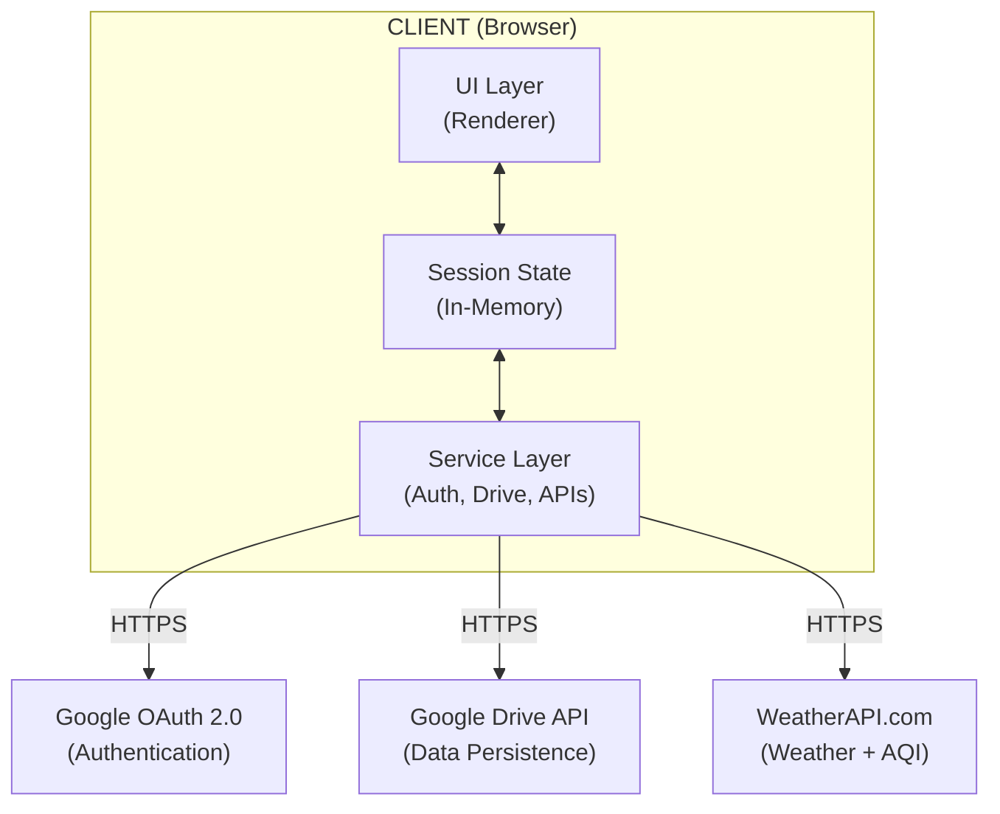

### 2.3 Component Summary

| Component | Responsibility |
|---|---|
| **UI Layer** | Renders the checklist, filters, history timeline, and export controls. Handles Day/Night mode. |
| **Session State Manager** | Holds the in-memory working copy of config, summary index, and current log draft. Discarded on tab close/refresh. |
| **Auth Service** | Manages Google OAuth 2.0 flow, token lifecycle, and session gating. |
| **Drive Service** | CRUD operations against the app folder in Google Drive (config, index, daily logs). |
| **Environment Service** | Fetches weather + AQI data from WeatherAPI.com using the user-supplied location string. |
| **Sync Engine** | Orchestrates boot sync (download index + config) and save sync (merge + upload). |
| **Export Engine** | Generates ZIP archives of daily JSON logs and CSV exports of the summary index. |

---

## 3. Data Architecture

### 3.1 Google Drive Folder Structure

```
My Drive/
└── SilentDynamicTracker/          ← App-managed folder (drive.file scope)
    ├── config.json                ← Master layout/schema configuration
    ├── summary_index.json         ← Lightweight index of all logged days
    └── logs/
        ├── 2026-11-01.json        ← Full daily payload
        ├── 2026-11-02.json
        └── ...
```

### 3.2 File Roles & Access Patterns

| File | Size Profile | Read Pattern | Write Pattern |
|---|---|---|---|
| `config.json` | Small (< 50 KB) | Boot + on config change | User adds/saves permanent question/option |
| `summary_index.json` | Medium (grows ~200 bytes/day → ~70 KB/year) | Boot (full download) | Every log save appends/updates an entry |
| `logs/YYYY-MM-DD.json` | Small per file (1–5 KB) | On-demand (lazy) | Log save; shallow merge if exists |

### 3.3 Data Flow — Boot Sequence

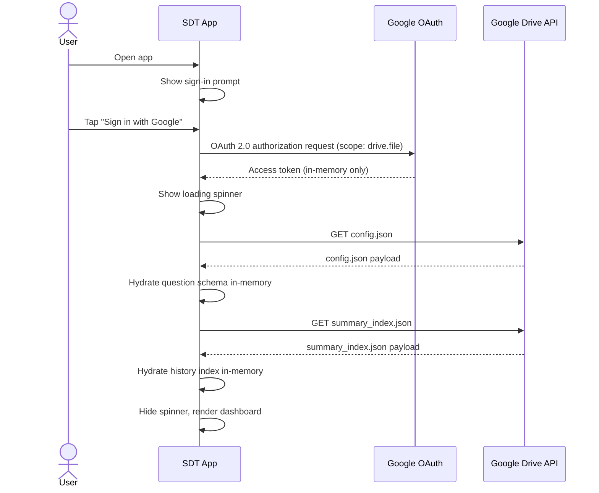

### 3.4 Data Flow — Save Sequence

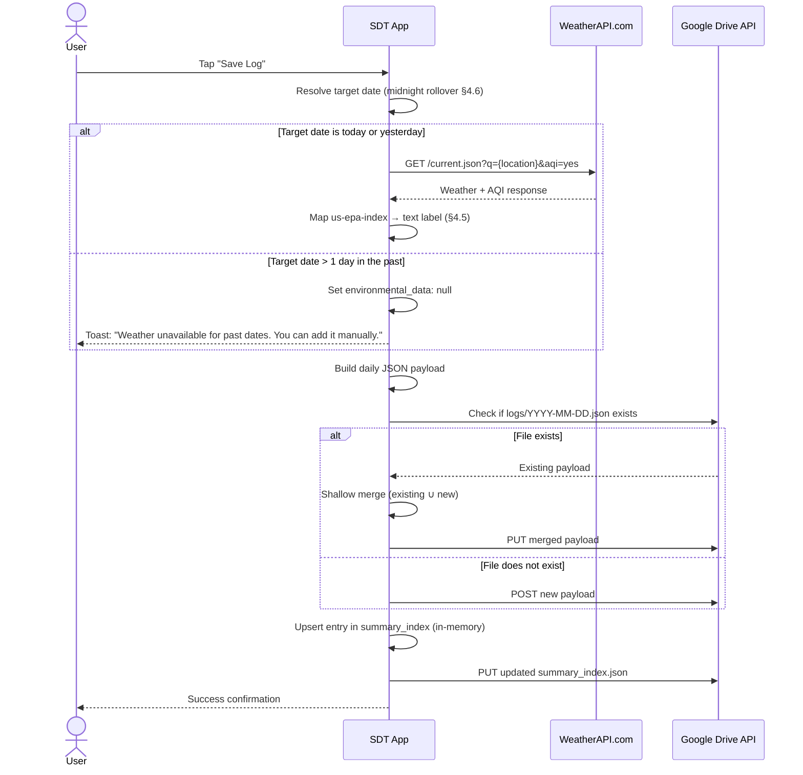

---

## 4. Component Design

### 4.1 Authentication & Session Gating

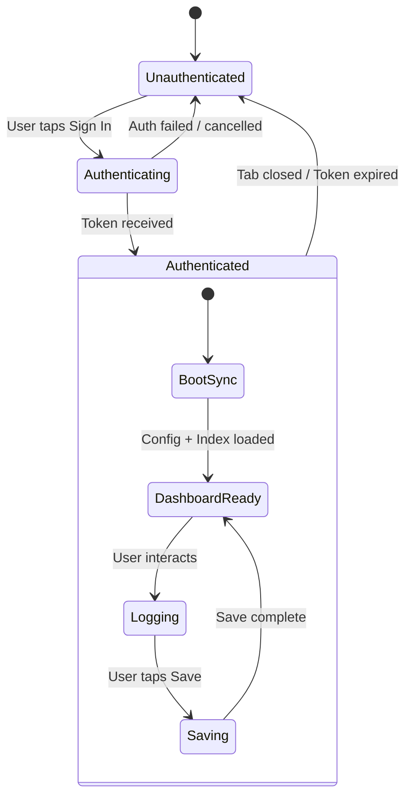

- **Mechanism:** Google OAuth 2.0 with `drive.file` scope.
- **Behaviour:** The entire app is behind the auth wall. If no valid token exists, the UI shows only a sign-in prompt — no dashboard, no data, no cached views.
- **Token Lifecycle:** Access token held in memory. Refresh handled via Google's JS SDK. Tab close = full logout for state purposes (token may persist in Google's session, but app state is wiped).

### 4.2 Sync Engine

#### 4.2.1 Boot Sync

1. Authenticate via Google OAuth.
2. Locate or create the `SilentDynamicTracker` app folder.
3. Download `config.json` → populate question schema in memory.
4. Download `summary_index.json` → populate history index in memory.
5. Show loading spinner during steps 2–4.
6. Render dashboard.

#### 4.2.2 Save Sync (Log Commit)

1. Resolve target date (apply midnight rollover logic — see §4.6).
2. **Date eligibility check** (see §4.5.5):
   - If target date is **today or yesterday** → call WeatherAPI.com for real-time weather + AQI.
   - If target date is **> 1 day in the past** → skip API call, set `environmental_data: null`, show info toast: *"Weather data unavailable for past dates. You can add it manually."*
3. Construct daily payload JSON from in-memory session selections.
4. Check if `logs/YYYY-MM-DD.json` exists on Drive:
   - **Exists →** Download, shallow-merge (preserve existing keys, overwrite/append updated keys), upload merged file.
   - **Does not exist →** Upload new file.
5. Upsert the corresponding entry in `summary_index.json`.
6. Upload updated `summary_index.json`.

#### 4.2.3 Merge Strategy (Shallow Merge)

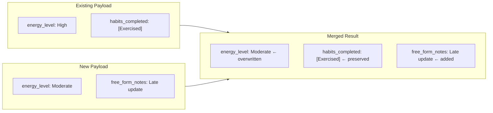

- **Scalar fields:** new value overwrites old.
- **Array fields (multi-select):** union/replace based on the source question type.
- **`free_form_notes`:** recommend **replace** since the user sees the existing text in the editor during merge.

### 4.3 UI Layer

#### 4.3.1 Layout Modes

| Mode | Trigger | Characteristics |
|---|---|---|
| **Mobile (primary)** | Viewport < 768px | Single column, full-width chips, large touch targets (min 48×48 dp), bottom-anchored save button. |
| **Desktop** | Viewport ≥ 768px | Multi-column grid, sidebar for filters/history, inline question blocks. |

#### 4.3.2 Day / Night Theme

| Property | Day Mode (default) | Night Mode |
|---|---|---|
| Background | Light (#FAFAFA) | Dark (#121212) |
| Text | Dark (#212121) | Light (#E0E0E0) |
| Accent chips | Vibrant fill | Muted/dim fill |
| Activation | System default / toggle | Manual toggle or system `prefers-color-scheme` |

#### 4.3.3 Checklist Rendering Pipeline

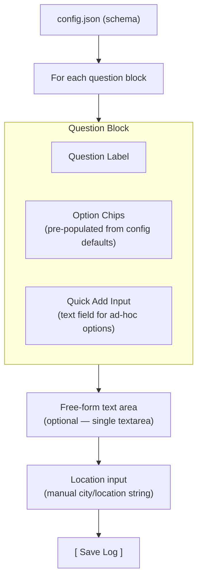

### 4.4 Dynamic Customisation (Quick Add)

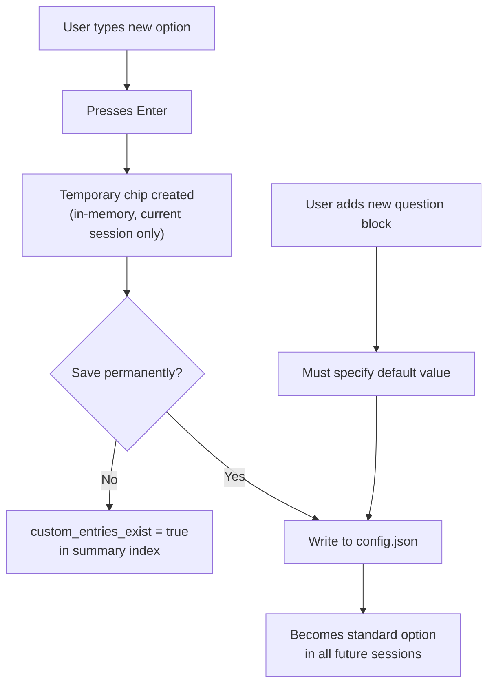

| Action | Scope | Persistence | Index Impact |
|---|---|---|---|
| Type new option → Enter | Current session chip | In-memory only (lost on refresh) | Sets `custom_entries_exist: true` |
| Tap "Save permanently" on a temp chip | Global schema | Written to `config.json` | No flag needed (becomes standard) |
| Add new question block + set default | Global schema | Written to `config.json` | No flag (becomes standard) |
| Free-form text note added | Current day | Written to daily payload | Sets `custom_entries_exist: true` |

### 4.5 Environment Service — WeatherAPI.com

SDT uses **WeatherAPI.com** as a single unified provider for both weather and air quality data. One GET request returns everything needed. The API is only called for **current or near-current dates**; past dates receive `null` environmental data that users can fill in manually.

#### 4.5.1 API Integration

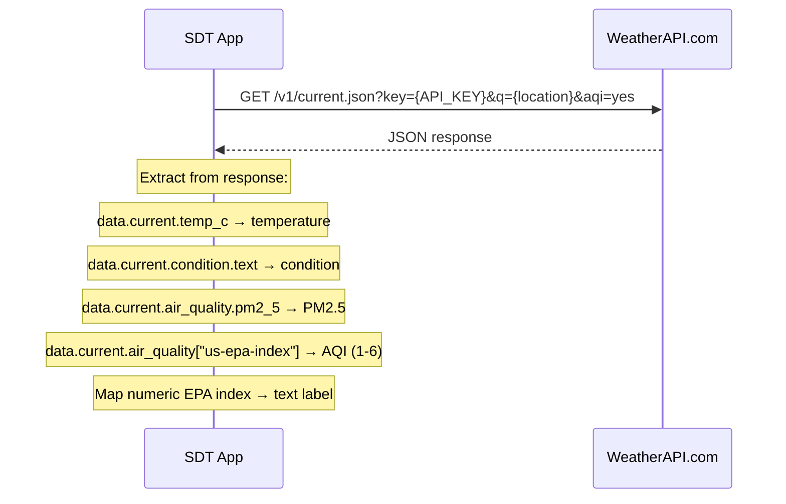

**Endpoint:**
```
GET https://api.weatherapi.com/v1/current.json?key={API_KEY}&q={location}&aqi=yes
```

**Example call:**
```javascript
const location = "Mumbai, India";
const apiKey = "YOUR_FREE_WEATHERAPI_KEY";

fetch(`https://api.weatherapi.com/v1/current.json?key=${apiKey}&q=${encodeURIComponent(location)}&aqi=yes`)
  .then(response => response.json())
  .then(data => {
      const environmental_data = {
          temperature: `${data.current.temp_c}C`,
          condition: data.current.condition.text,
          aqi: mapEpaIndexToText(data.current.air_quality["us-epa-index"]),
          aqi_numeric: data.current.air_quality["us-epa-index"],
          pm25: data.current.air_quality.pm2_5
      };
  });
```

#### 4.5.2 US EPA Index — Text Mapping

The WeatherAPI.com `us-epa-index` field returns a numeric value (1–6). For human-readable summaries and the summary index, SDT maps this to descriptive text:

| Numeric Value | Text Label | Description |
|---|---|---|
| 1 | Good | Air quality is satisfactory, little or no risk. |
| 2 | Moderate | Acceptable; some pollutants may concern unusually sensitive individuals. |
| 3 | Unhealthy for Sensitive Groups | Sensitive groups may experience health effects. |
| 4 | Unhealthy | Everyone may begin to experience health effects. |
| 5 | Very Unhealthy | Health alert — significant health effects for everyone. |
| 6 | Hazardous | Emergency conditions — entire population is affected. |

**Mapping function:**
```javascript
function mapEpaIndexToText(epaIndex) {
    const EPA_LABELS = {
        1: "Good",
        2: "Moderate",
        3: "Unhealthy for Sensitive Groups",
        4: "Unhealthy",
        5: "Very Unhealthy",
        6: "Hazardous"
    };
    return EPA_LABELS[epaIndex] || "Unknown";
}
```

#### 4.5.3 Impact on Data Schema

With the EPA text mapping and manual edit support, the data stored in each file becomes:

**Daily payload** (`logs/YYYY-MM-DD.json`) — stores both raw and mapped values, plus a `source` indicator:
```json
{
  "environmental_data": {
    "temperature": "31C",
    "condition": "Clear",
    "aqi": "Moderate",
    "aqi_numeric": 2,
    "pm25": 36.4,
    "source": "api"
  }
}
```

The `source` field tracks where the environmental data came from:

| `source` value | Meaning |
|---|---|
| `"api"` | Auto-fetched from WeatherAPI.com at save time. |
| `"manual"` | Manually entered or edited by the user. |
| `null` / absent | No environmental data available (past date, API failure, not yet filled). |

**Summary index** (`summary_index.json`) — stores human-readable text:
```json
{
  "date": "2026-11-09",
  "location": "Mumbai",
  "weather_summary": "31°C, Clear",
  "aqi_summary": "Moderate",
  "custom_entries_exist": true
}
```

> **Note:** `aqi_summary` is a text string (e.g. `"Moderate"`) rather than a numeric value. When `environmental_data` is `null`, `weather_summary` and `aqi_summary` are also `null` in the index — until the user manually fills them in.

#### 4.5.4 Error Handling & Date Eligibility

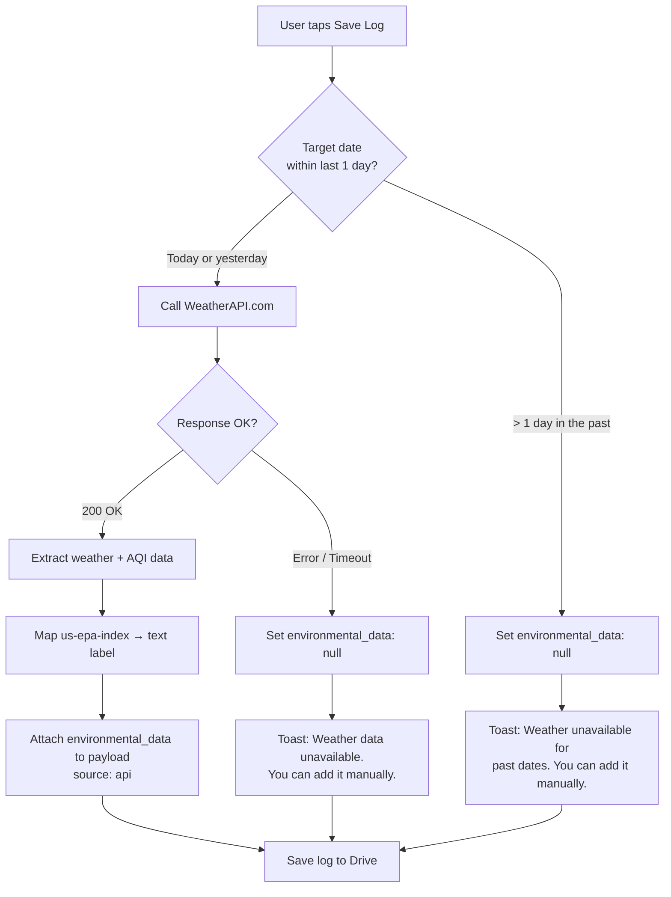

**Rules:**
- **Today or yesterday** → call WeatherAPI.com. If it fails, save with `environmental_data: null`.
- **> 1 day in the past** → skip the API call entirely. Save with `environmental_data: null`.
- In both `null` cases, show an informational (non-blocking) toast notifying the user they can add weather/AQI data manually.

#### 4.5.5 Manual Environmental Data Editing

Users can **manually enter or edit** environmental data on any saved entry — regardless of whether it was auto-fetched, failed, or skipped due to a past date.

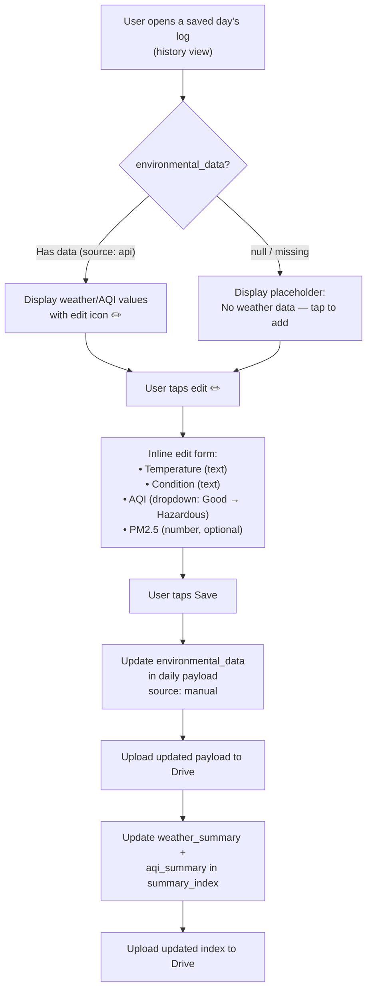

**Editable fields:**

| Field | Input Type | Validation |
|---|---|---|
| Temperature | Free text (e.g. `"28C"`) | Optional — any string accepted |
| Condition | Free text (e.g. `"Partly Cloudy"`) | Optional — any string accepted |
| AQI | Dropdown: Good, Moderate, Unhealthy for Sensitive Groups, Unhealthy, Very Unhealthy, Hazardous | Maps to `aqi_numeric` 1–6 automatically |
| PM2.5 | Number input | Optional — non-negative decimal |

**Behaviour:**
- Editing sets `source: "manual"` on the environmental data block.
- The update follows the same Drive write path as a normal save — update the daily payload, then upsert the summary index entry with updated `weather_summary` and `aqi_summary`.
- Manual edits are allowed on **any** entry: entries where the API succeeded, entries where the API failed, and entries for past dates that never called the API.

### 4.6 Midnight Rollover Logic

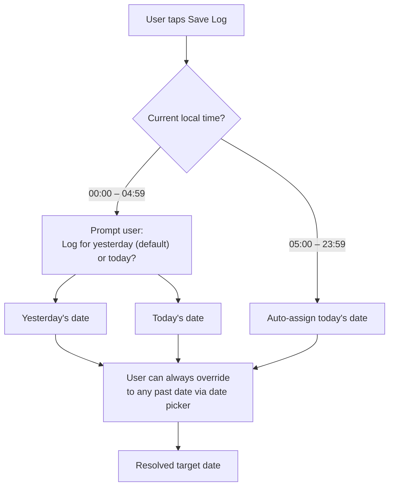

### 4.7 History, Filtering & Timeline

#### 4.7.1 Hierarchical Grouping

```
Timeline View
├── 2026
│   ├── November (3 entries)
│   ├── October (28 entries)
│   └── ...
├── 2025
│   └── ...
```

Rendered from `summary_index.json` — no network calls needed for browsing.

#### 4.7.2 Compound Filter Architecture

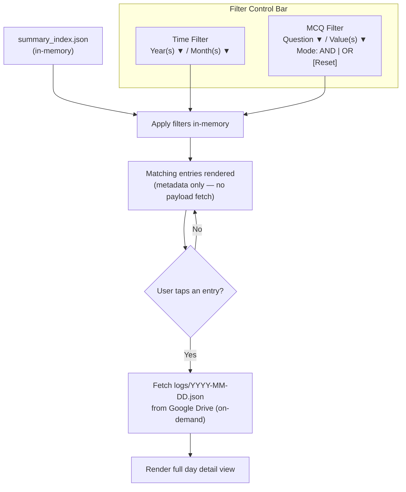

#### 4.7.3 Filter Logic

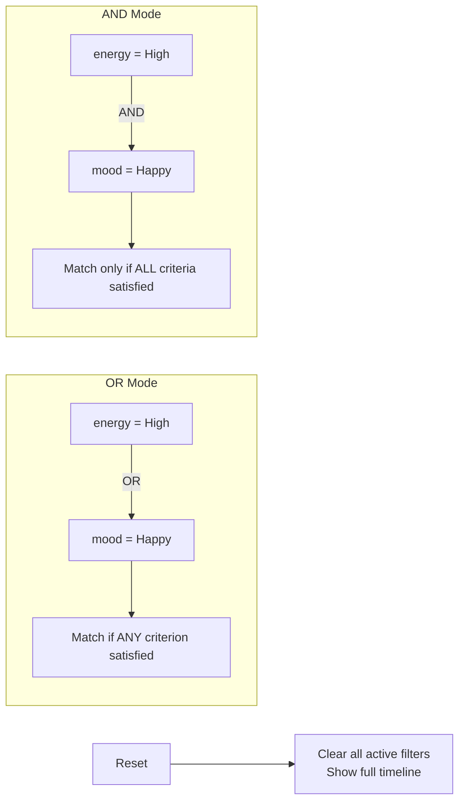

### 4.8 Export Engine

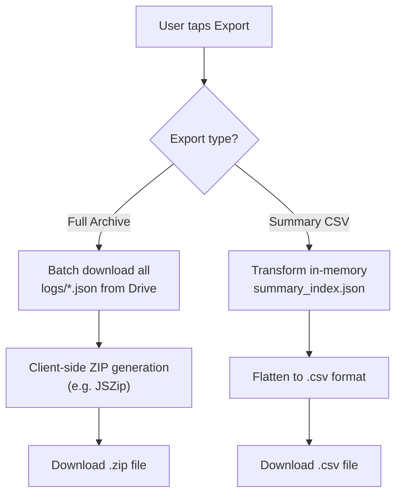

| Export Type | Source | Output Format | Mechanism |
|---|---|---|---|
| Full archive | All `logs/*.json` files | `.zip` containing individual JSON files | Batch download from Drive → client-side zip generation (e.g. JSZip) |
| Summary CSV | `summary_index.json` | Flat `.csv` file | Client-side transformation, no Drive reads needed beyond cached index |

---

## 5. End-to-End Flow — Complete Session

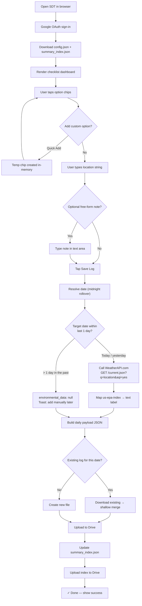

---

## 6. Security Considerations

| Concern | Mitigation |
|---|---|
| **Data at rest** | All data resides in user's Google Drive, encrypted by Google. |
| **OAuth scope** | Minimal `drive.file` scope — app can only access files it creates. |
| **Token storage** | Access tokens in memory only. No local persistence. |
| **WeatherAPI key** | API key should be proxied through a lightweight edge function to avoid client-side exposure. Consider environment-level secrets. |
| **XSS / Injection** | Sanitise all user inputs (Quick Add text, free-form notes, location string) before rendering and before building JSON payloads. |

---

## 7. Performance Budget & Constraints

| Metric | Target |
|---|---|
| **Boot to interactive** | < 3 seconds (after OAuth, on 4G) |
| **Boot data transfer** | < 100 KB (config + index for ~1 year of data) |
| **Save latency** | < 2 seconds (payload build + API call + Drive upload) |
| **WeatherAPI call** | < 500ms (single lightweight GET) |
| **Lighthouse mobile score** | > 90 (Performance) |

---

## 8. Key Technical Decisions & Trade-offs

| Decision | Rationale | Trade-off |
|---|---|---|
| **No local persistence** | Simplicity, privacy, no sync conflicts. | Requires network for every session. No offline mode. |
| **Single summary index file** | Enables instant in-memory filtering without downloading all logs. | Index file grows linearly (~70 KB/year). Acceptable for years of use. |
| **Shallow merge on save** | Supports partial logging (daytime + nighttime). | Cannot track granular field-level history or diffs. |
| **Manual location** | Privacy, no GPS battery drain. | Slight friction; user must type city name each session. |
| **WeatherAPI.com (single provider)** | One GET call returns both weather and AQI. Free tier available. Reduces integration complexity. | Single point of failure for environmental data. Mitigated by graceful fallback (save without env data). |
| **Real-time only, manual edit for past dates** | Free tier only supports `/current.json`. Keeps costs at zero. Manual editing gives users full control. | Past-date entries require manual input for weather/AQI. Acceptable since primary use case is same-day logging. |
| **EPA text labels in index** | Human-readable summaries without needing a lookup table at read time. | Slightly larger index entries. Raw numeric value preserved in daily payload for filtering. |
| **Client-side zip/CSV export** | No server needed. Fully stateless. | Large archives may be slow on low-end mobile devices. |
| **Day Mode as default** | Broader usability across all times of day. | Late-night users must toggle to Night Mode (or rely on system `prefers-color-scheme`). |

---

## 9. Future Considerations (Out of Scope for v1)

- **PWA / Service Worker caching** for basic offline shell rendering.
- **Shared journals** (multi-user access to a Drive folder).
- **Data visualization** (charts/trends from summary index).
- **Reminders / notifications** (push notification at user-configured bedtime).
- **Voice input** as an alternative to free-form text typing.

---

## 10. Glossary

| Term | Definition |
|---|---|
| **SDT** | Silent Dynamic Tracker — this application. |
| **Summary Index** | `summary_index.json` — lightweight metadata file listing all logged days without full text content. |
| **Daily Payload** | `logs/YYYY-MM-DD.json` — complete log for a single day including all responses, environmental data, and notes. |
| **Quick Add** | In-line input allowing users to create ad-hoc checklist options during a session. |
| **Shallow Merge** | Field-level merge strategy where new values overwrite existing ones without deep recursive merging. |
| **Midnight Rollover** | Logic that assigns late-night sessions (00:00–04:59) to the previous calendar day by default. |
| **RWA** | Responsive Web App — a web application built with responsive design for cross-device compatibility. |
| **US EPA Index** | United States Environmental Protection Agency air quality scale (1–6) returned by WeatherAPI.com, mapped to text labels: Good, Moderate, Unhealthy for Sensitive Groups, Unhealthy, Very Unhealthy, Hazardous. |
