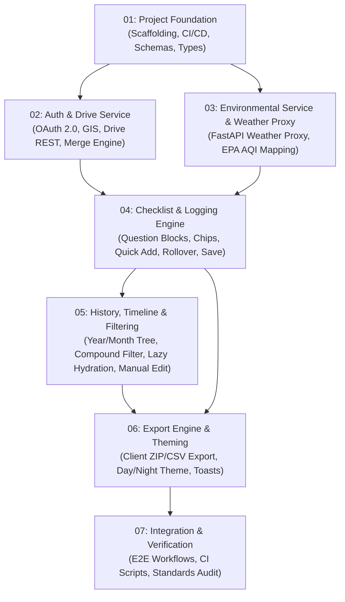

# Master Execution Plan — Silent Dynamic Tracker (SDT)

**Version:** 1.0  
**Date:** 2026-11-12  
**Based on:** [001_high_level_design.md](../design/high_level/001_high_level_design.md) & [001_initial.md](../requirements/001_initial.md)  
**Coding Standards:** [python_coding_standards.md](../coding_standards/python_coding_standards.md) & [frontend_coding_standards.md](../coding_standards/frontend_coding_standards.md)  
**Status:** Approved for Implementation

---

## 1. Executive Summary & Architecture Overview

Silent Dynamic Tracker (SDT) is a stateless, mobile-first journaling web application designed for rapid, silent, late-night logging. It stores all data in the user's personal Google Drive account (`drive.file` scope) with zero local database persistence (no IndexedDB, LocalStorage, or SQLite). State exists in-memory during an active session and is wiped on tab close.

### Core Architecture Components
1. **Frontend Client (`frontend/`):** React 18+ with TypeScript (strict mode), Vite, Vitest, and CSS Modules. Decomposed into single-responsibility functional components, custom hooks (`use*`), pure TypeScript service classes, and shared utilities.
2. **Backend Proxy (`backend/`):** Lightweight Python 3.13 FastAPI service using `uv`. Proxies WeatherAPI.com calls to keep the API key secure (mitigating client exposure as specified in HLD §6), normalizes environmental data, and maps US EPA AQI indices (1–6) to descriptive text labels. Follows strict Python OOP (one class per file, member ordering, method length ≤ 20 lines).
3. **Google Drive Cloud Storage:**
   - App folder: `My Drive/SilentDynamicTracker/`
   - Master configuration: `config.json` (< 50 KB)
   - Lightweight index: `summary_index.json` (~200 bytes/day, downloaded at boot)
   - Daily logs: `logs/YYYY-MM-DD.json` (lazy-loaded on demand)

---

## 2. Plan Phasing & Dependency Graph

The implementation is broken down into 7 sequential, modular phases. Each phase is self-contained with its own plan document, explicit deliverables, unit test requirements (≥ 90% coverage), and local CI verification gates.



---

## 3. Phase Index & Plan Document Directory

| Phase | Plan Document | Scope & Objectives | Key Artifacts |
|---|---|---|---|
| **01** | [`01_project_foundation.md`](./01_project_foundation.md) | Bootstrap backend (`pyproject.toml`, ruff, mypy, pytest) & frontend (`package.json`, Vite, tsc, Vitest, ESLint). Implement domain models, schemas, and shared constants. | `backend/app/models/`, `frontend/src/types/`, `frontend/src/constants/` |
| **02** | [`02_auth_and_drive_service.md`](./02_auth_and_drive_service.md) | Google Identity Services (GIS) OAuth 2.0 (`drive.file`), Drive API service class (folder init, CRUD for config, index, logs), shallow payload merge engine, and auth barrier. | `GoogleAuthService.ts`, `DriveService.ts`, `PayloadMergeService.ts`, `useAuth.ts`, `useDriveSync.ts` |
| **03** | [`03_environmental_service_and_weather_proxy.md`](./03_environmental_service_and_weather_proxy.md) | FastAPI WeatherAPI proxy (`/api/weather`), US EPA AQI mapping (1-6 → Good...Hazardous), date eligibility check, error fallback, and frontend `WeatherService.ts`. | `WeatherService.py`, `WeatherController.py`, `WeatherService.ts`, `useWeather.ts` |
| **04** | [`04_checklist_and_logging_engine.md`](./04_checklist_and_logging_engine.md) | Rapid-tap checklist UI, QuestionBlock, OptionChip, Quick Add, midnight rollover logic (00:00–04:59 prompt), location input, notes textarea, and save orchestrator. | `ChecklistDashboard.tsx`, `QuestionBlock.tsx`, `OptionChip.tsx`, `SaveLogOrchestrator.ts` |
| **05** | [`05_history_timeline_and_filtering.md`](./05_history_timeline_and_filtering.md) | Hierarchical Year/Month timeline grouping, compound filter engine (Time + MCQ AND/OR modes, Reset), lazy payload hydration on tap, and manual environmental data editor modal. | `TimelineView.tsx`, `FilterBar.tsx`, `FilterEngineService.ts`, `DayDetailModal.tsx`, `EnvironmentalEditModal.tsx` |
| **06** | [`06_export_engine_and_theming.md`](./06_export_engine_and_theming.md) | Bulk export engine (client-side ZIP via JSZip, summary CSV export), Day/Night theme system (Day mode default), responsive layout tuning, and toast alert system. | `ZipExportService.ts`, `CsvExportService.ts`, `ThemeService.ts`, `ExportModal.tsx`, `ToastContainer.tsx` |
| **07** | [`07_integration_and_verification.md`](./07_integration_and_verification.md) | End-to-end integration workflows, automated local verification script, test coverage audit (> 90%), and coding standards compliance verification. | `verify_all.sh`, E2E test suites, standards audit report |

---

## 4. Coding Standards Adherence Matrix

Every plan document enforces strict compliance with the project's coding standards:

### 4.1 Python Coding Standards (`backend/`)
- **Virtual Environment:** Python 3.13 in `~/python_envs/p313_llm`.
- **Package Management:** `uv pip install` / `uv run`.
- **Strict OOP:** All functions and members must be encapsulated inside classes. No free-standing functions. Entry point class in `main.py` invoked under `if __name__ == "__main__":`.
- **Member Ordering:**
  1. Class-level constants (`_CONSTANT_NAME`)
  2. `__init__()`
  3. Public methods
  4. Protected methods (`_method`)
  5. Private methods (`__method`)
- **Method & File Limits:** Method body ≤ 20 logical lines (HARD LIMIT). File total ≤ 500 lines.
- **One Class Per File:** Filename matches class name in snake_case (e.g., `WeatherService` → `weather_service.py`).
- **No Magic Values:** Class constants prefixed with `_` or extracted to `app/constants/`.
- **Type Annotations & Docstrings:** 100% type hints on all parameters and returns. Google/NumPy style docstrings on all classes and public methods.
- **CI Verification:**
  - Lint: `cd backend && uv run --with ruff ruff check .`
  - Type Check: `cd backend && uv run --with mypy mypy app`
  - Tests & Coverage: `cd backend && uv run pytest` (fail under 90% branch coverage).

### 4.2 Frontend Coding Standards (`frontend/`)
- **Node & Package Management:** Node.js v22 LTS, `npm`.
- **Component & Module Architecture:**
  - Functional components only. No business logic in components (delegated to hooks or services).
  - Custom hooks (`use*`) encapsulate stateful logic, side effects, and data fetching.
  - Service classes (pure TypeScript classes, no React dependencies) encapsulate API calls and business algorithms.
  - Pure utility functions allowed only for stateless formatters/validators.
- **Member & File Ordering:**
  - Component: Imports → Types → Constants → Component function (destructuring → context → state → refs → memo → callbacks → effects → handlers → guard clauses → JSX return) → Export.
  - Service class: Static constants → Constructor → Public methods → Private methods (`_method`).
- **Method & File Limits:** Function/component body ≤ 30 logical lines. JSX return block ≤ 50 lines. File total ≤ 300 lines.
- **One Component Per File:** PascalCase for components (`UserProfile.tsx`), camelCase for hooks (`useAuth.ts`), PascalCase for services (`DriveService.ts`).
- **No Magic Values:** File-scoped constants or extracted to `src/constants/`.
- **Type Safety:** Strict TypeScript (`"strict": true`), no `any` types.
- **CI Verification:**
  - Lint: `cd frontend && npm run lint`
  - Type Check: `cd frontend && npx tsc --noEmit`
  - Tests & Coverage: `cd frontend && npm run test -- --coverage` (fail under 90% branch coverage).

---

## 5. Repository Directory Layout

The finalized repository structure planned across all phases:

```
silent-dynamic-tracker/
├── backend/
│   ├── pyproject.toml
│   ├── app/
│   │   ├── __init__.py
│   │   ├── main.py
│   │   ├── constants/
│   │   │   ├── __init__.py
│   │   │   ├── app_constants.py
│   │   │   └── weather_constants.py
│   │   ├── models/
│   │   │   ├── __init__.py
│   │   │   ├── config_model.py
│   │   │   ├── summary_index_model.py
│   │   │   ├── environmental_model.py
│   │   │   └── daily_payload_model.py
│   │   ├── services/
│   │   │   ├── __init__.py
│   │   │   └── weather_service.py
│   │   └── controllers/
│   │       ├── __init__.py
│   │       └── weather_controller.py
│   └── tests/
│       ├── __init__.py
│       ├── test_config_model.py
│       ├── test_summary_index_model.py
│       ├── test_daily_payload_model.py
│       ├── test_weather_service.py
│       ├── test_weather_controller.py
│       └── test_main.py
├── frontend/
│   ├── package.json
│   ├── tsconfig.json
│   ├── vite.config.ts
│   ├── vitest.config.ts
│   ├── .eslintrc.cjs
│   ├── index.html
│   └── src/
│       ├── main.tsx
│       ├── App.tsx
│       ├── constants/
│       │   ├── appConstants.ts
│       │   ├── epaConstants.ts
│       │   ├── weatherConstants.ts
│       │   └── checklistConstants.ts
│       ├── types/
│       │   ├── config.ts
│       │   ├── summaryIndex.ts
│       │   ├── environmental.ts
│       │   └── dailyPayload.ts
│       ├── utils/
│       │   ├── dateUtils.ts
│       │   └── stringUtils.ts
│       ├── services/
│       │   ├── GoogleAuthService.ts
│       │   ├── DriveService.ts
│       │   ├── PayloadMergeService.ts
│       │   ├── WeatherService.ts
│       │   ├── DateResolutionService.ts
│       │   ├── SessionStateService.ts
│       │   ├── SaveLogOrchestrator.ts
│       │   ├── FilterEngineService.ts
│       │   ├── TimelineGroupingService.ts
│       │   ├── CsvExportService.ts
│       │   ├── ZipExportService.ts
│       │   └── ThemeService.ts
│       ├── context/
│       │   ├── AuthContext.tsx
│       │   ├── DriveSyncContext.tsx
│       │   └── ToastContext.tsx
│       ├── hooks/
│       │   ├── useAuth.ts
│       │   ├── useDriveSync.ts
│       │   ├── useWeather.ts
│       │   ├── useChecklist.ts
│       │   ├── useMidnightRollover.ts
│       │   ├── useHistoryFilter.ts
│       │   ├── useDayDetail.ts
│       │   ├── useTheme.ts
│       │   └── useToast.ts
│       ├── components/
│       │   ├── auth/
│       │   │   ├── AuthBarrier.tsx
│       │   │   └── SignInPrompt.tsx
│       │   ├── checklist/
│       │   │   ├── ChecklistDashboard.tsx
│       │   │   ├── QuestionBlock.tsx
│       │   │   ├── OptionChip.tsx
│       │   │   ├── QuickAddInput.tsx
│       │   │   ├── FreeFormNotes.tsx
│       │   │   ├── LocationInput.tsx
│       │   │   └── MidnightRolloverModal.tsx
│       │   ├── history/
│       │   │   ├── HistoryDashboard.tsx
│       │   │   ├── TimelineView.tsx
│       │   │   ├── TimelineEntryCard.tsx
│       │   │   ├── FilterBar.tsx
│       │   │   ├── DayDetailModal.tsx
│       │   │   └── EnvironmentalEditModal.tsx
│       │   ├── export/
│       │   │   └── ExportModal.tsx
│       │   ├── theme/
│       │   │   └── ThemeToggle.tsx
│       │   └── common/
│       │       ├── LoadingSpinner.tsx
│       │       ├── ToastContainer.tsx
│       │       └── ToastItem.tsx
│       └── styles/
│           ├── global.css
│           └── theme.module.css
├── documentation/
│   ├── coding_standards/
│   │   ├── python_coding_standards.md
│   │   └── frontend_coding_standards.md
│   ├── design/high_level/
│   │   └── 001_high_level_design.md
│   ├── requirements/
│   │   └── 001_initial.md
│   ├── plan/
│   │   ├── 00_master_execution_plan.md
│   │   ├── 01_project_foundation.md
│   │   ├── 02_auth_and_drive_service.md
│   │   ├── 03_environmental_service_and_weather_proxy.md
│   │   ├── 04_checklist_and_logging_engine.md
│   │   ├── 05_history_timeline_and_filtering.md
│   │   ├── 06_export_engine_and_theming.md
│   │   └── 07_integration_and_verification.md
│   └── prompts/
│       └── template.md
└── scripts/
    └── verify_all.sh
```

---

## 6. Execution Protocol for Developers & AI Agents

When executing any plan in this directory:
1. **Read the Target Plan:** Load the phase plan document (e.g., `documentation/plan/01_project_foundation.md`).
2. **Review Coding Standards:** Read `documentation/coding_standards/python_coding_standards.md` and `frontend_coding_standards.md`.
3. **Activate Environment:**
   - Python: `source ~/python_envs/p313_llm/bin/activate`
   - Node: Ensure Node v22+ is in PATH (`node -v`).
4. **Implement Classes & Units:** Build the code following strict OOP/functional boundaries, member ordering, and line limits.
5. **Write Unit Tests:** Implement comprehensive test suites targeting ≥ 90% branch coverage.
6. **Execute Local CI:** Run all three stages of the local CI pipeline for the modified workspace (backend and/or frontend).
7. **Complete Verification Checklist:** Validate all criteria in the plan's checklist table before marking the phase complete.

